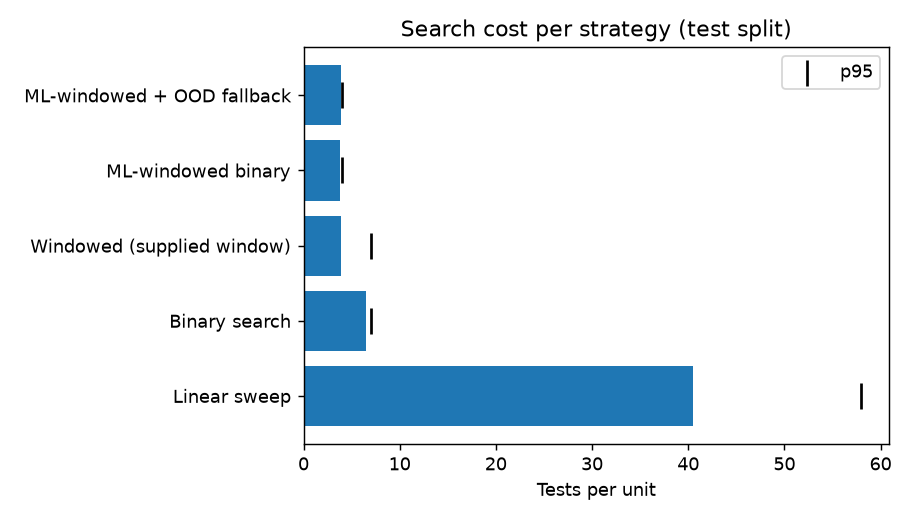
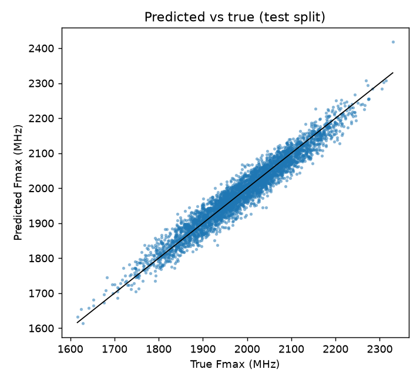
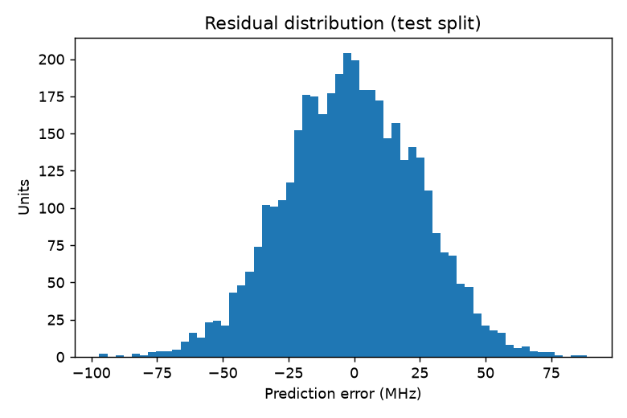

# AI-Driven Adaptive Fmax Prediction — Technical Report

> All results come from the supplied **synthetic** dataset and a simulated tester. They show feasibility only and are not validated production performance.

## 1. Data
- 6000 rows; splits {'test': 4000, 'train': 1500, 'calibration': 500} (predefined splits preserved).
- Missing values: none; duplicate rows: 0; duplicate unit IDs: 0.
- Extreme values (3×IQR, flagged not removed): {'ro_03': 1, 'ro_09': 1}.
- Recomputed true bin agrees with `true_bin_mhz` for 99.92% of rows.
- Model inputs: 15 allowlisted features + 4 ring-oscillator aggregates. All PRD §5.4 leakage columns are blocked in code (`features.assert_no_leakage`).

## 2. Model comparison
Selection uses 5-fold cross-validation on the training split only; test metrics are reported, not used to choose.

| model             |   cv_rmse_mhz |   cv_r2 |   test_mae_mhz |   test_rmse_mhz |   test_r2 |   test_mape_pct |   latency_us_per_unit |
|:------------------|--------------:|--------:|---------------:|----------------:|----------:|----------------:|----------------------:|
| linear_regression |        24.369 |   0.942 |         20.307 |          25.381 |     0.941 |           1.023 |                 1.286 |
| random_forest     |        25.291 |   0.938 |         21.298 |          26.769 |     0.934 |           1.074 |                55.511 |
| gradient_boosting |        25.417 |   0.937 |         21.167 |          26.541 |     0.935 |           1.068 |                11.043 |
| xgboost           |        25.521 |   0.937 |         21.149 |          26.608 |     0.935 |           1.067 |                 9.708 |

**Selected: `linear_regression`**. Test MAE 20.31 MHz, RMSE 25.38 MHz, R² 0.9405, MAPE 1.02%. The prediction supplied with the dataset (`fmax_pred_mhz`, evaluation only) scores RMSE 26.94 MHz, R² 0.9330.

## 3. Calibrated uncertainty
Split conformal prediction calibrated on the 500-unit calibration split, target coverage 95%.

| Mode | Test coverage | Mean width (MHz) |
|---|---:|---:|
| Absolute residual (used) | 94.65% | 96.6 |
| Normalized (per-unit width) | 95.20% | 104.1 |

OOD detector (feature range + Mahalanobis at the 99.9th training percentile): test-split fallback rate 0.60%; on 500 synthetic process-excursion units it routed 78.80% to full search.

## 4. Search optimization
Simulated tester: 1600–2400 MHz grid, 10 MHz step, σ_test = 4.0 MHz per test, 30 ms per step. Bins [1800, 1900, 2000, 2100, 2200] MHz assigned from the **measured** Fmax with an 8 MHz guard band.

| method                     |   mean_tests |   p95_tests |   mean_time_ms |   saving_vs_binary_pct |   saving_vs_linear_pct |   mean_abs_error_mhz |   bin_accuracy |   over_bin_escapes |   under_bin_rate |   edge_extension_rate |   fallback_rate |
|:---------------------------|-------------:|------------:|---------------:|-----------------------:|-----------------------:|---------------------:|---------------:|-------------------:|-----------------:|----------------------:|----------------:|
| Linear sweep               |      40.4732 |          58 |       1214.2   |              -527.103  |                 0      |               5.8357 |         0.9028 |                  0 |           0.0972 |                0      |           0     |
| Binary search              |       6.454  |           7 |        193.62  |                 0      |                84.0537 |               5.769  |         0.905  |                  0 |           0.095  |                0      |           0     |
| Windowed (supplied window) |       3.9432 |           7 |        118.297 |                38.9022 |                90.2571 |               5.7574 |         0.9048 |                  0 |           0.0952 |                0.1048 |           0     |
| ML-windowed binary         |       3.8392 |           4 |        115.177 |                40.5136 |                90.5141 |               5.6921 |         0.9062 |                  0 |           0.0938 |                0.0388 |           0     |
| ML-windowed + OOD fallback |       3.87   |           4 |        116.1   |                40.0372 |                90.4381 |               5.7304 |         0.9045 |                  0 |           0.0955 |                0.0402 |           0.006 |

### Guard-band sensitivity (adaptive method)
|   guard_band_mhz |   bin_accuracy |   over_bin_escape_rate |   under_bin_rate |
|-----------------:|---------------:|-----------------------:|-----------------:|
|                0 |         0.9728 |                 0.0142 |           0.013  |
|                4 |         0.9045 |                 0      |           0.0955 |
|                8 |         0.9045 |                 0      |           0.0955 |
|               12 |         0.805  |                 0      |           0.195  |
|               16 |         0.805  |                 0      |           0.195  |

Under-binning is driven by the guard band and grid quantisation, not by the model: every measured method shows about the same under-bin rate at a given guard band.

### Why bins are not assigned from predictions alone
|   k_sigma |   guard_band_mhz |   bin_accuracy |   over_bin_escape_rate |   under_bin_rate |
|----------:|-----------------:|---------------:|-----------------------:|-----------------:|
|         0 |           0      |         0.7962 |                 0.0962 |           0.1075 |
|         1 |          25.1012 |         0.6945 |                 0.022  |           0.2835 |
|         2 |          50.2023 |         0.4938 |                 0.002  |           0.5042 |
|         3 |          75.3035 |         0.2812 |                 0      |           0.7188 |

## 5. Acceptance criteria (PRD §9.4)
| Criterion | Result | Met |
|---|---|:-:|
| R² ≥ 0.90 | 0.9405 | ✅ |
| Interval coverage ≈ 95% | 94.65% | ✅ |
| Test-iteration reduction ≥ 30% vs binary | 40.0% | ✅ |
| Speed-bin accuracy ≥ 95% | 90.45% | ❌ |
| Zero known leakage | allowlist enforced + unit test | ✅ |
| Fallback mechanism tested | unit tests + 78.80% detection on shifted units | ✅ |

If the bin-accuracy criterion is not met, the shortfall is under-binning, which comes from the 8 MHz measurement guard band and 10 MHz grid and affects conventional binary search equally. Over-bin escapes are the safety metric; see the table in section 4.

## 6. Limitations
- Synthetic data and a simulated tester; noise levels and timings are assumptions.
- Single voltage/temperature corner.
- With 4,000 test units, zero observed escapes bounds the escape rate only to roughly 1 in 1,000.

 